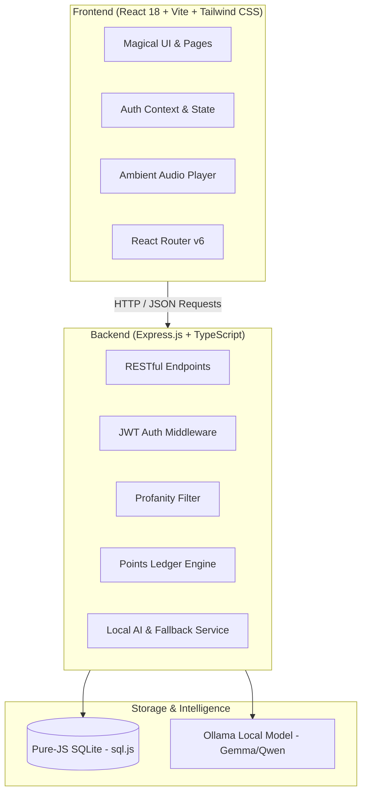

# 🏰 Hogwarts Owl Post & Sorting Portal
### *Where Fandom Meets Innovation — Official Submission for CROSSOVER Hackathon*

---

## 📌 Project Title
**Hogwarts Owl Post & Sorting Portal**  
*An Open-Source, AI-Powered Wizarding Experience & Community Platform*

---

## 👥 Team Details
- **Team Name**: Team Gynfrindor
- **Members**:
  1. **Member 1**: Yojitha Boyina
  2. **Member 2**: Sudhishna Mallavarapu
---

## 🎯 Problem Statement
Most fandom web experiences and online Hogwarts sorting quizzes are **static, repetitive, and non-interactive**:
1. **Generic & Predictable Quizzes**: Traditional sorting quizzes always present the same fixed 5 questions with obvious choices, leading to repetitive results and lack of excitement.
2. **Disconnected Ecosystem**: Existing Harry Potter fandom tools exist in silos—a sorting quiz on one site, timetable templates on another, and static fan forums with no shared progression or gamification.
3. **Overuse of Paid / Closed AI APIs**: Most modern AI-powered applications rely heavily on proprietary cloud APIs (like OpenAI GPT-4, Anthropic Claude), which creates privacy risks, recurring API costs, and breaches open-source hackathon rules.
4. **IP & Copyright Risks**: Unofficial fandom projects frequently violate Warner Bros. and Wizarding World intellectual property by using copyright-protected film stills, official soundtracks, and trademarked logos.

---

## 💡 The Solution: Hogwarts Owl Post & Sorting Portal
A comprehensive, all-in-one wizarding portal that bridges fandom with modern open-source software engineering:
- **Adaptive, Randomized Sorting Hat**: Shuffled from a rich pool of cute, funny, engaging 1-sentence questions with emojis, evaluated by an AI trait scoring engine that ensures fair house distribution.
- **Dynamic Weekly Timetable Generator**: Generates personalized Hogwarts class schedules based on house and selected magical electives.
- **Asynchronous Owl Post Messaging**: Students send letters via named courier owls (*Hedwig Jr., Nimbus, Artemis*) with delivery delays and an AI-powered "Magical Flair" rewriting engine.
- **House Forums with Live House Cup Leaderboard**: Four house-specific forums tied to an automated **Points Ledger** where posts, comments, and upvotes award house points in real time.
- **100% Open-Source & Copyright-Safe**: Built using pure open-source libraries (`React`, `Express`, `sql.js`, `Ollama`), original SVG designs, open Google Fonts (`Cinzel`, `Inter`), and custom-synthesized celesta audio.

---

## ✨ Core Features & Highlights

| Feature | Description | Key Tech |
|---|---|---|
| 🎩 **Sorting Hat Ceremony** | Randomized questions per student, animated SVG hat, instant transitions, and balanced 4-house distribution. | React, Framer Motion, Ollama / Local AI |
| 📅 **Personalized Timetable** | Interactive interest selector generating weekly classes, study periods, and club activities. | React, Express, REST API |
| 🦉 **Owl Post System** | Send/receive letters with simulated owl flight delay and AI magical styling assistant. | Express API, Content Moderation Filter |
| 💬 **Great Hall Forums** | House-filtered discussion boards with upvotes, threaded comments, and profanity filtering. | SQLite (`sql.js`), JWT Auth |
| 🏆 **The House Cup** | Real-time standings visualized as animated sand/gem hourglasses. | CSS Animations, Framer Motion |
| 🔐 **Account & Recovery** | Full authentication with bcrypt password hashing and 3-step Owl Mail password recovery. | bcryptjs, jsonwebtoken |
| 🎵 **Magical Ambience** | Original synthesized celesta chime background music with floating player widget. | Web Audio / HTML5 Audio |

---

## 🛠️ System Architecture & Tech Stack



### Technology Breakdown
- **Frontend**: React 18, Vite 6, TypeScript, Tailwind CSS, Framer Motion, Lucide React
- **Backend**: Express.js, TypeScript, Node.js
- **Database**: SQLite powered by pure-JS `sql.js` (no native compile/build-tools required)
- **Security & Auth**: bcryptjs, JSON Web Tokens (JWT)
- **AI / LLM Layer**: Ollama local inference (Gemma 3 / Qwen 2.5) with instant deterministic fallback
- **Typography**: Google Fonts (*Cinzel* & *Inter* - SIL Open Font License)
- **Audio**: Custom synthesized 44.1kHz Celesta & Glockenspiel ambient soundtrack

---

## 📜 Hackathon & Licensing Compliance

This project was built strictly adhering to the **CROSSOVER Hackathon Guidelines**:
1. **100% Open-Source**: All dependencies and tools are MIT, Apache 2.0, ISC, or OFL licensed. See [docs/LICENSES.md](docs/LICENSES.md).
2. **Zero Paid APIs / Zero Proprietary AI**: No cloud credits, paid OpenAI/Claude endpoints, or commercial platforms were used.
3. **Original Assets & IP Compliance**: No Warner Bros. trademarked crests, film captures, official fonts, or master soundtrack audio recordings are used. All emblems, animations, and sound files were originally authored.
4. **Verifiable AI Usage**: See [docs/AI_USAGE.md](docs/AI_USAGE.md) for transparent documentation of AI models and integration boundaries.

---

## 🚀 Quick Start Guide

### 1. Prerequisites
- **Node.js** (v18 or higher)
- **Git**

### 2. Installation
```bash
# Clone the repository
git clone <your-repository-url>
cd HarryPotter

# Install backend dependencies
cd server
npm install

# Install frontend dependencies
cd ../client
npm install
```

### 3. Run Locally

Open two terminal windows:

**Terminal 1 (Backend API - Port 3001):**
```bash
cd server
npm start
```

**Terminal 2 (Frontend Client - Port 5173):**
```bash
cd client
npm run dev
```

Visit **`http://localhost:5173`** in your browser!

### 4. Multi-Device LAN Access (Other Laptops on Same Wi-Fi)
- Find your local IP address (e.g. `10.0.8.206`).
- Other laptops on the same Wi-Fi can enroll and play directly at:
  👉 **`http://<YOUR_LOCAL_IP>:5173`**

---

## 👥 Contributions & Verification
All code, database schema migrations, routes, and components were created and committed originally during the CROSSOVER Hackathon window. Each team member understands and can explain every part of the codebase during demonstration.
